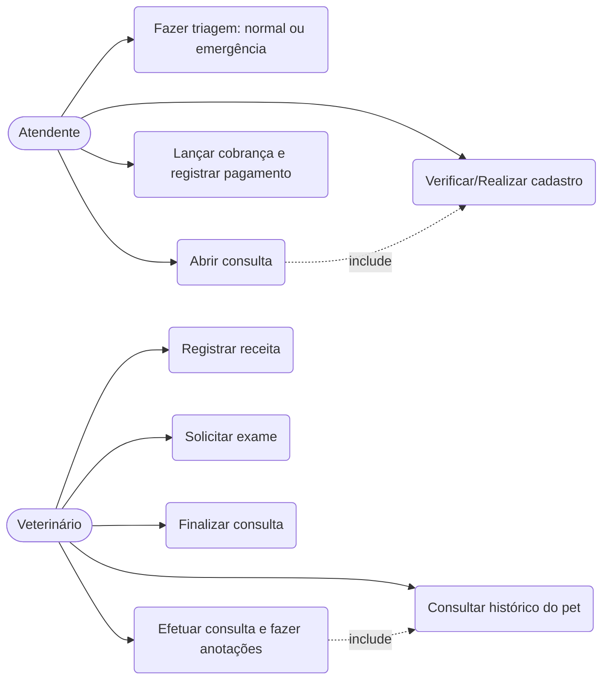
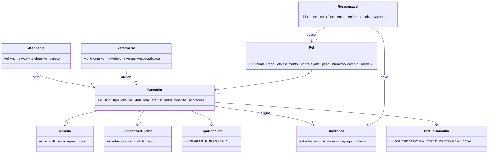

# Etapa 4 — Modelagem do domínio · MeuPet

## 1. Entidades e regras de negócio
Oito entidades: Responsável, Pet, Atendente, Veterinário, Consulta, Receita, SolicitaçãoExame e Cobrança.

| Regra | Descrição |
|---|---|
| RN01 | Todo pet pertence a exatamente um responsável; o responsável pode ter vários pets. |
| RN02 | A consulta referencia pet, responsável e veterinário válidos; o responsável deve ser o do pet. |
| RN03 | O tipo da consulta é NORMAL ou EMERGENCIA e é definido na triagem, antes do atendimento. |
| RN04 | A receita identifica consulta, veterinário prescritor, data de emissão e prescrição. |
| RN05 | A solicitação de exame está vinculada à consulta e tem descrição. |
| RN06 | A cobrança tem responsável, data, descrição, valor ≥ 0 e situação (paga/em aberto). |
| RN07 | Atendente: cadastros, triagem, consulta e cobrança. Veterinário: registros clínicos. |
| RN08 | Consulta FINALIZADA não aceita novas anotações, receitas ou exames. |

## 2. Diagrama de casos de uso

## 3. Diagrama de classes

**Invariantes (OCL informal):** `consulta.responsavel = consulta.pet.responsavel` · `cobranca.valor >= 0` · `consulta.status = FINALIZADA` ⇒ nenhum novo registro clínico.

## 4. Decisões de modelagem
- **TipoConsulta virou enumeração.** No modelo da disciplina era uma classe com código e texto; só existem dois valores fixos, então uma classe a mais não agrega comportamento.
- **SolicitaçãoExame virou entidade.** O texto da atividade cita exames na consulta, mas não os modelava. Como entidade, o pedido é rastreável (HU06).
- **Receita liga à consulta**, e o veterinário e o paciente são derivados dela. Isso elimina a redundância CRMV/paciente e evita receitas inconsistentes com a consulta.
- **Consulta guarda o responsável** (RN02) para preservar quem respondia pelo pet no dia do atendimento, mesmo que o pet seja transferido depois.
- **Status da consulta** foi acrescentado para a fila de atendimento e para a RN08.
- **Pendente:** o relacionamento Pet–Responsável é 1:N. Se a clínica quiser tutores múltiplos, vira N:N; isso deve ser perguntado ao stakeholder.
