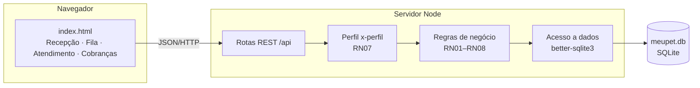
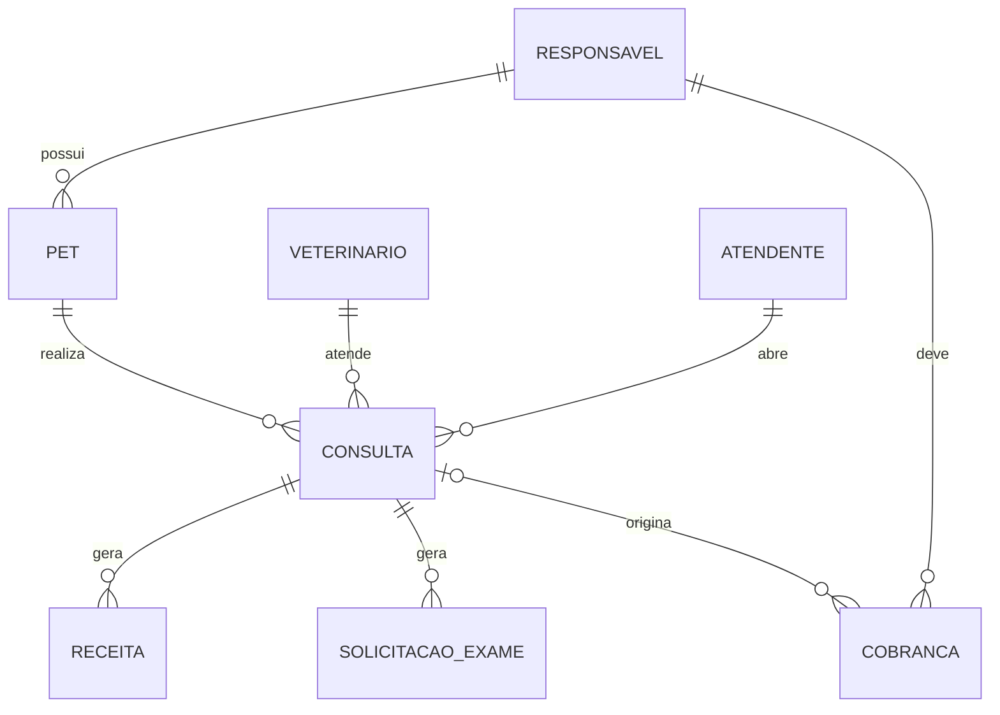

# Etapa 5 — Projeto e arquitetura · MeuPet

## 1. Arquitetura escolhida: cliente–servidor em camadas
| Camada | Tecnologia | Responsabilidade |
|---|---|---|
| Apresentação | HTML/CSS/JS (`public/index.html`) | Telas por perfil, validação básica de campos e mensagens de erro. |
| API / Regras | Node.js + Express (`src/app.js`) | Rotas REST, autorização por perfil (RN07), regras RN01–RN08. |
| Persistência | SQLite (`db/schema.sql`, `src/db.js`) | Armazenamento e integridade (PK, FK, UNIQUE, CHECK). |

**Por que camadas e não microsserviços ou MVC com templates:** o sistema é pequeno, com uma única clínica e uma equipe de 2 a 3 pessoas. Um servidor único serve o front e a API, o que reduz infraestrutura (o material pede escopo pequeno e funcionando). A separação front/API permite trocar a interface sem mexer nas regras.

**Por que SQLite:** não exige servidor de banco, o arquivo `meupet.db` é criado sozinho e as restrições relacionais continuam valendo. Para produção multiusuário, trocar por PostgreSQL altera apenas `src/db.js` e a sintaxe de `AUTOINCREMENT`.

## 2. Diagrama de componentes

## 3. Módulos, coesão e acoplamento
- **Coesão:** cada grupo de rotas trata um assunto (responsáveis, pets, consultas, cobranças). As regras ficam junto da operação que protegem.
- **Acoplamento baixo:** o front só conhece o contrato JSON da API; a API só conhece o banco por `abrirBanco()`. `criarApp(db)` recebe o banco por parâmetro, o que permitiu testar com banco em memória.
- **Pontos de melhoria:** `src/app.js` concentra rotas e regras. Se o sistema crescer, separar em `rotas/` e `servicos/`.
- **Segurança (limitação assumida):** o perfil vem do cabeçalho `x-perfil`, escolhido na tela. É suficiente para demonstrar RN07, mas **não é autenticação**. Em produção é necessário login com senha e sessão/token.

## 4. Modelo de dados

| Tabela | Chave primária | Chaves estrangeiras | Restrições |
|---|---|---|---|
| responsavel | id | — | `cpf` UNIQUE, `nome` e `fone` NOT NULL |
| pet | id | responsavel_id → responsavel | responsavel_id NOT NULL (RN01), peso > 0, microchip UNIQUE |
| veterinario | id | — | `crmv` UNIQUE |
| atendente | id | — | `cpf` UNIQUE |
| consulta | id | pet_id, responsavel_id, veterinario_id, atendente_id | tipo IN (NORMAL, EMERGENCIA); status IN (AGUARDANDO, EM_ATENDIMENTO, FINALIZADA) |
| receita | id | consulta_id, veterinario_id | prescricao NOT NULL |
| solicitacao_exame | id | consulta_id | descricao NOT NULL |
| cobranca | id | responsavel_id, consulta_id (opcional) | valor ≥ 0 (RN06); pago IN (0,1) |

O SQL completo está em `db/schema.sql`.
